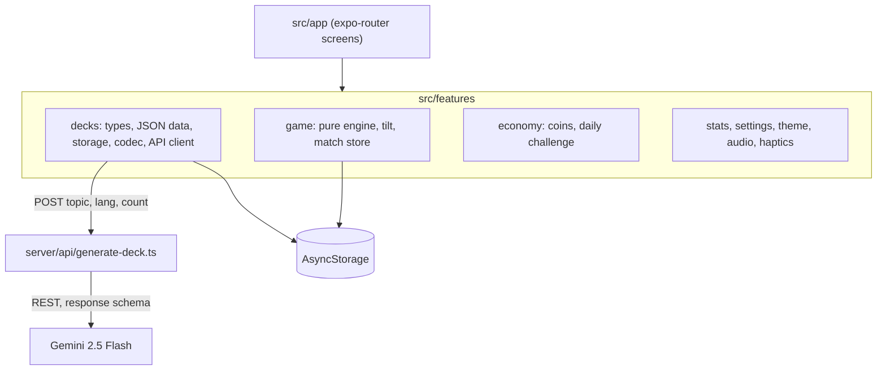

# AnyDeck

(repo: anydeck-ai-party-game)

*A "phone on your forehead" guessing game where an LLM writes a playable deck on any topic.*


Heads Up style games ship a fixed catalog of decks. AnyDeck keeps the same game, tilt down for correct and tilt up for skip, and adds a generator: type "Tunisian street food" or "obscure Star Wars ships", pick a language and a card count, and a deck exists a few seconds later. Decks are plain JSON, so they also travel as pasteable codes and QR codes.

The model call lives behind a small server function rather than in the app, so the API key never ships in the binary. The server validates input, constrains the model to a response schema, and rate-limits per client. Everything else, including scores, stats, settings and saved decks, stays on the device.

## Features

**Tilt controls with tap fallback** — the accelerometer reads tilt down as correct and tilt up as skip; tap zones cover simulators and accessibility needs. The play screen floods with the deck colour and shifts green or red as the phone tilts.

**AI deck generation** — a `POST` to the server returns title, icon, colour, description, language and 10 to 60 cards, in any language the model supports.

**Match modes** — quick play, pass-and-play with named players, and teams with standings across rounds. A solo mode shows up to four indirect clue words per card, vaguest first, and compares typed guesses by normalized edit distance (`text-match.ts`). Rounds can be timed or unlimited, decks can be merged, and a mystery mode hides the deck until the results screen.

**Deck sharing** — `encodeDeck` produces a base64 JSON code with an `ADK1.` prefix that is small enough for a QR code and can also be pasted as text.

**Bundled decks** — twelve JSON decks (animals, anime, classic, countries, food, football, history, memes, movies and TV, programming, science, video games).

**Local economy** — coins earned by playing unlock premium decks, a daily challenge awards coins, and coins unlock accent themes. There are no real-money payments.

**Audio and haptics** — sound effects are generated by `scripts/generate-sounds.js`, so no audio assets are licensed or downloaded. Haptics fire on every action and respect a setting.

## How it works



### Key decisions

- **Screens are controllers, features own logic**: `src/app` only routes and composes. The game engine (`use-game-engine.ts`, `text-match.ts`) is pure logic with unit tests and no UI imports.
- **Server proxy for the model call**: a function deployed separately keeps `GEMINI_API_KEY` out of the app binary. It has no dependencies, using plain `fetch` against the Gemini REST endpoint with a response schema and a whitelist of icon names the app can render.
- **Gemini 2.5 Flash on the free tier**: the cost of a generation is zero at launch volume. The trade-off is a rate limit that has to be enforced by this project: 10 decks per hour per client, held in memory per serverless instance. It does not survive a restart or coordinate across instances, and the code notes Upstash Redis as the replacement.
- **Decks as data**: a deck is JSON with a `lang` tag, icon and colour. New categories, other languages and remote decks need no code change.
- **No emoji, one icon registry**: icons come from a curated Lucide set in `src/components/icon.tsx`, and deck icons are data, so the AI picks from the same registry the UI renders.
- **Payments left as seams**: `purchaseSubscription` and `showRewardedAd` in `economy.tsx` are stubs, and the premium screen says so. Nothing in the app charges money.

## Tech stack

| Technology | Role | Why |
| --- | --- | --- |
| Expo 57, expo-router | App shell and routing | — |
| React Native 0.86, React 19 | UI | — |
| TypeScript (strict) | Language | — |
| expo-sensors, expo-haptics, expo-audio | Tilt, haptics, sound | Tilt needs a physical device |
| Reanimated, Gesture Handler | Animation | — |
| AsyncStorage | On-device persistence | No accounts, no backend state |
| react-native-qrcode-svg | Deck QR codes | — |
| Gemini 2.5 Flash | Deck generation | Free tier |
| Jest, jest-expo | Tests | — |

## Getting started

Requirements: Node.js 20 or newer. Tilt controls need a physical phone with Expo Go; use the tap zones in a simulator.

```bash
npm install
npx expo start
```

AI generation is optional. To enable it, deploy `server/` to Vercel (or any Web-standard runtime) with `GEMINI_API_KEY` set, then point the app at it:

```bash
cp .env.example .env
# EXPO_PUBLIC_ANYDECK_API_URL=https://your-deployment.vercel.app
```

With the variable unset the app hides AI generation. Production builds use EAS profiles from `eas.json`: `npx eas build --profile production --platform all`.

## Configuration

| Variable | Where | Required | Description |
| --- | --- | --- | --- |
| `EXPO_PUBLIC_ANYDECK_API_URL` | App | No | Base URL of the deployed generation server |
| `GEMINI_API_KEY` | Server | For generation | Google AI Studio key |

## API

`POST /api/generate-deck` — body `{ topic: string, lang?: string, count?: number }`. Topic is capped at 120 characters and count at 10 to 60. Returns `{ title, icon, color, description, lang, cards[] }`, or an error when the client exceeds 10 requests per hour.

## Testing

```bash
npm test
```

28 tests cover the game engine (round flow), typed-guess matching, and the deck share codec.

## Roadmap

| Status | Item |
| --- | --- |
| Done | Core game, three multiplayer modes, solo mode, local economy, deck codes, AI generation server |
| Done | App icons, splash, EAS profiles, privacy policy (`PRIVACY.md`: nothing collected, generation requests carry only topic, language and count) |
| Planned | Subscription (RevenueCat) and rewarded ads (AdMob), currently stubs |
| Planned | More bundled non-English decks, Arabic and French first |
| Planned | Redis-backed rate limiting and entitlement checks on the server |

## License

**Source-available, not open source.** AnyDeck is published under the
[PolyForm Strict License 1.0.0](LICENSE): you may read, run, and learn from the code
for personal, research, or evaluation use.

You may **not** use it commercially, redistribute it, rebrand it, or publish modified
versions without written permission. Copyright (c) 2026 Yassine Krichen. All rights
not granted by the license are reserved.

For commercial licensing or collaboration: krichenyassine22@gmail.com
